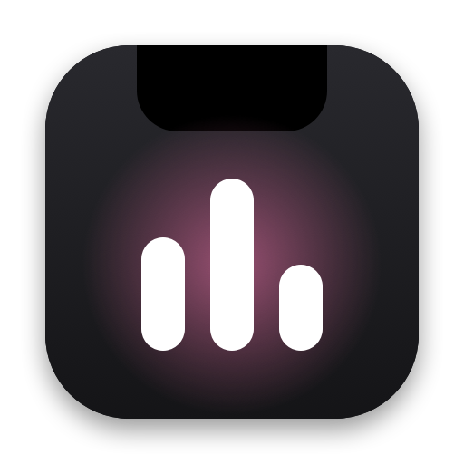
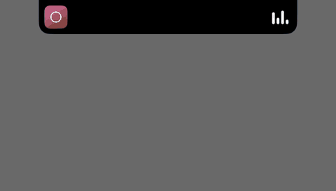

<p align="center">
  
</p>

<h1 align="center">Warble <sup>beta</sup></h1>

<p align="center">
  Your music, in your Mac's notch.<br>
  Free, open source, and private: no account, no cloud, no analytics.
</p>

<p align="center">
  
  
  <a href="LICENSE"></a>
  <a href="https://github.com/sponsors/LorcanChinnock"></a>
</p>

<p align="center">
  <a href="https://warble.lorcanchinnock.com">Website</a> ·
  <a href="docs/roadmap.md">Roadmap</a> ·
  <a href="CHANGELOG.md">Changelog</a>
</p>

<p align="center">
  
</p>

Warble shows what's playing in the notch at the top of your Mac's screen. Hover over the notch or click it to see the song, then play, pause, skip or switch speakers. When nothing is playing, it stays out of sight.

Warble is in beta: it works, and it's still being built. [docs/roadmap.md](docs/roadmap.md) lists what each release will include.

## Install

```sh
brew install lorcanchinnock/tap/warble
```

Or [download the latest release](https://warble.lorcanchinnock.com/download) and drag Warble into Applications. It needs macOS 15 or later, on Apple silicon or Intel. Warble isn't notarized by Apple yet, so macOS blocks it the first time you open it: the [install steps](https://warble.lorcanchinnock.com/#install) show how to open it anyway. The [user guide](https://warble.lorcanchinnock.com/docs/) covers the rest. Warble follows your Mac's language: English, German, Spanish, French, Italian, Japanese, Korean, Brazilian Portuguese or Simplified Chinese.

## Features

- **What's playing, in the notch.** The album art sits on one side, and on the other a few bars move while it plays. Open it to see the song on a soft glow in the album art's colours.
- **Controls.** Play, pause, skip, move through the song, and turn shuffle and repeat on or off when the app has them. Turn on going back 15 seconds or forward 30 in a podcast or an audiobook. Drag the volume bar, or scroll over the notch to change the volume. Turn on swiping left or right over the notch to skip, and dragging the album art into a message, a note or a folder.
- **Switch speakers.** Move your Mac's sound to its own speakers, headphones or AirPods from the notch.
- **Any player.** Apple Music, Spotify, podcast apps and video in your browser.
- **Calm by default.** A paused song stays for a few seconds, then Warble gets out of the way. When nothing is playing, it hides behind the notch and uses no CPU. Hover over the notch to see the last song you played and play it again.
- **Every Mac.** Macs without a notch, and external displays, get a virtual one that shows the title of what's playing, and you choose which displays show it.
- **Help when it can't see.** If something stops Warble seeing what's playing, a small "!" appears beside the notch. Click it to see what's wrong and how to fix it.
- **For everyone.** Works with VoiceOver and with the keyboard alone, and follows Increase Contrast and Reduce Motion.
- **Lyrics, if you want them.** Turn them on, and the line being sung shows under the notch, in step with the song. Click the lyrics button in the player to see the lines around it.
- **Settings, if you want them.** Open at login, a larger text size, how long a paused song stays, a message when the track changes, even over full-screen apps, lyrics, swiping to skip, skipping by seconds in podcasts, dragging the album art out, hiding from screen sharing and recordings, and your own keyboard shortcuts, one of which opens the notch. Right-click the notch for Settings or to quit, even with the menu bar icon hidden.

## Privacy

Warble collects nothing. It has no account, no cloud and no analytics, and it only goes online to check for updates, after you agree, and to look up lyrics on [LRCLIB](https://lrclib.net) if you turn them on. Then it sends each song's title, artist, album and length, and nothing else.

## Contributing

Bug reports, ideas and pull requests are welcome. [CONTRIBUTING.md](CONTRIBUTING.md) explains how to build Warble from source, run the tests and send a change. To report a security problem, see [SECURITY.md](SECURITY.md).

Warble shares its repository layout, tooling and release pipeline with [Shot](https://github.com/LorcanChinnock/shot), a screenshot app by the same author.

## Support

Warble is free, with no ads. [Sponsoring](https://github.com/sponsors/LorcanChinnock) keeps it that way and helps pay to notarize it.

## License

Warble is free software under the [GNU General Public License v3.0](LICENSE).

## Acknowledgements

Warble updates itself with [Sparkle](https://sparkle-project.org), under the MIT license, and reads what's playing with [MediaRemote Adapter](https://github.com/ungive/mediaremote-adapter), under the BSD 3-Clause license. See [Acknowledgements](Resources/Acknowledgements.txt).
