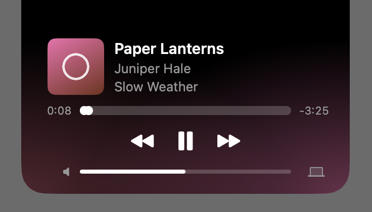

Warble is in beta. You can use it every day, but it's still being built, so things change between versions and a few rough edges remain. It needs macOS 15 or later, and runs on Apple silicon and Intel Macs.

## Install Warble

With [Homebrew](https://brew.sh), paste this into Terminal:

```sh
brew install lorcanchinnock/tap/warble
```

Or [download Warble](/download), open the zip and drag **Warble** into your Applications folder.

## Open it the first time

Warble isn't notarized by Apple yet, so macOS blocks it the first time you open it. You only do this once.

1. Open Warble from your Applications folder. macOS says it can't check Warble for malicious software. Click **Done**.
2. Open **System Settings**, choose **Privacy & Security**, and scroll down to **Security**.
3. Click **Open Anyway** next to the message about Warble, then confirm with your password or Touch ID.

A small icon of three bars appears in the menu bar, and the notch looks just as it did before. Warble shows nothing else until something plays.

## See what's playing

1. Play something in any app: Music, Spotify, a podcast app, or a video in your browser.
2. The notch slides out a little. The album art sits on its left, and on its right a few bars move while it plays.
3. Hover over the notch. It opens into the player, with the song, how far through it you are, and the controls.



Move the pointer away and the notch closes again. [Control playback](/docs/control-playback/) covers everything the player does.

When you pause, the song stays in the notch for 10 seconds, then Warble hides behind the camera. You can make that a minute, or until something else plays, in Settings. When nothing is playing, Warble shows nothing and does nothing until a song starts. If you point at the notch then, a small card shows the last song that played, with a button to play it again, and goes when you move away. Until a song has played since Warble opened, the card says "Nothing playing" instead.

> [!TIP]
> To have Warble there after you restart your Mac, turn on **Open at login** in **Settings…**, from the menu bar icon.

## Updates

Warble asks once whether it should check for updates automatically. Whatever you choose, you can check at any time with **Check for Updates…** in the menu bar icon's menu. Warble also goes online to find the album cover for a song playing in your browser, since a browser only gives it a frame of the video. That search sends the song's title and artist to Apple's iTunes Search and nothing else, and no other app's song is looked up. When you click the artist on the open notch, Warble looks up the artist: for Spotify it reads the song's page on Spotify's website, and for a YouTube video it asks YouTube for the video's channel.

> [!NOTE]
> On a display without a notch that has the menu bar, Warble draws a notch of its own at the top of the screen. See [External displays](/docs/external-displays/).
