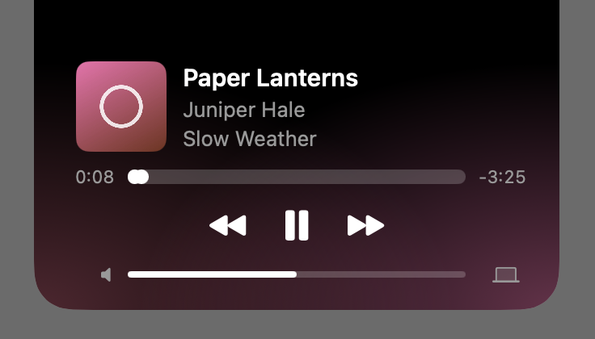

While something plays, the notch shows the album art and a few moving bars. Open it to control the song.

## Open the player

1. Hover over the notch for a moment.
2. The player shows the album art, the song, the artist and the album, with the controls underneath.

To close it, move the pointer away, click anywhere else, or press <kbd>Esc</kbd>.

## Play, pause and skip

- Click the play or pause button in the middle.
- Click the buttons either side of it to go back or skip to the next song.
- If the app has shuffle or repeat, their buttons appear at the left and right ends. Click repeat once to repeat everything, and again to repeat just the one song.

The keyboard's play/pause, next and previous keys work as they always have.

## Move through a song

1. Find the bar under the song, with the time played on its left and the time left on its right.
2. Click a point on the bar, or drag along it and let go where you want to be.

While the pointer is over the bar, the time at that point shows just above it, so you can see where a click will take you before you click. While you drag, it shows the time you'll land on when you let go. A live stream has no end, so it shows no time there.

## Change the volume

- Drag along the volume bar at the bottom of the player.
- Or scroll over the notch with two fingers on a trackpad, or with your mouse's wheel. Scroll up for louder and down for quieter. This works even when the notch is closed, while something plays.

To mute, click the speaker at the left end of the volume bar. It shows a line through it while your Mac is muted, and the bar drops to empty. Click it again to unmute at the volume you had before.

## Move through the song or skip with a trackpad

With two fingers on the notch, slide sideways to move through the song, right to go forward and left to go back, as far as you slide. Flick sideways quickly to skip: a flick to the right plays the next song and a flick to the left plays the previous one. Like scrolling for volume, it works while the notch is closed.

The volume is your Mac's own, so it changes everything you hear, not just the app in the notch. The speaker symbol at the right end of the bar picks where the sound plays. See [Switch speakers](/docs/switch-speakers/).

A title, artist or album that is too long for the card waits a moment after the notch opens and then scrolls slowly past in a loop while the song plays. With **Reduce motion** on, it ends in "…" instead.

> [!TIP]
> Click the album art, the title or anywhere else on the notch's background to bring the app that's playing to the front. For a song playing in Safari, Chrome, Brave, Edge, Arc or Vivaldi, Warble picks the tab it's playing in. The first time, macOS asks whether Warble may control that browser; if you say no, Warble just brings the browser forward.
>
> Click the artist to open their page: in Spotify for a Spotify song, and on YouTube for a YouTube video in one of those browsers. For anything else, including Apple Music, Warble can't be sure which artist page is the right one, so the click opens the app instead, as the album art does.

## Add a song to your Favourites in Music

If you use Apple's Music app, Warble can show a heart beside the song's title on the open notch. The heart is off until you turn on **Heart for Music's Favourites** in [Settings](/docs/settings/).

1. Play a song in Music and open the notch.
2. Click the heart. A filled heart means the song is in your Favourites, and an outline means it isn't.

Warble checks the song each time you open the notch, so a song you favourite in Music shows a filled heart the next time you open it. The first time, macOS asks whether Warble may control Music; if you say no, the heart doesn't show. It also doesn't show for a song Music can't add to Favourites, or for any app other than Music, since no other player lets Warble read or set a like.

## The notch menu

Right-click the notch, or Control-click it, for a short menu. It starts with the app that's playing, such as **Open Spotify**, and then has the same items as the menu bar icon's menu, in the same order: **About Warble**, **Check for Updates…**, **Settings…** and **Quit Warble**.

While a song is on, the menu also has **Copy Song and Artist**, under the app's name, which copies the song's name and artist as one line, such as "Heroes – David Bowie", ready to paste into a message. Extras in the name such as "- Remastered 2009" are left out.

When a new version of Warble is waiting, the menu bar icon shows a small dot, and both menus say **Update to** and the version in place of **Check for Updates…**. Choose it to see what's new and install it. While an update downloads, the same item shows how far it's got, such as **Downloading 0.2.0 (53%)…**, and choosing it shows the download again.
