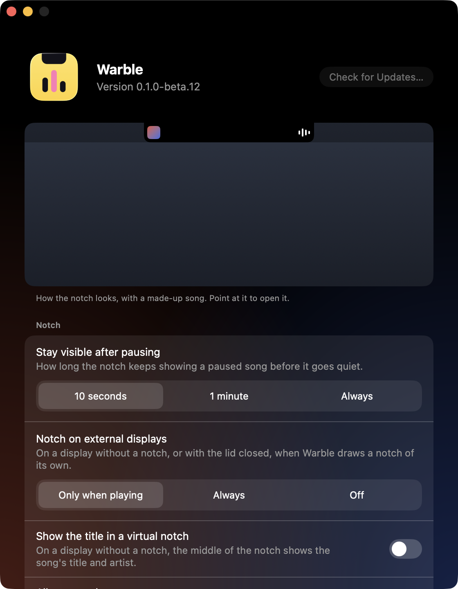
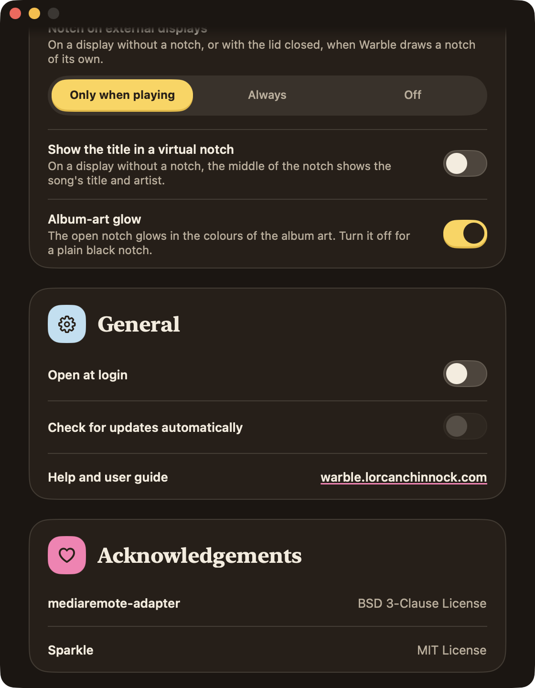

Warble works without changing anything. The things you may want to set are how long a paused song stays in the notch, whether it opens when you log in and, on a display without a notch, whether the notch shows the title.

## Open Settings

1. Click the Warble icon in the menu bar, or right-click the notch. You can also Control-click it.
2. Choose **Settings…**.

The right-click menu also opens the app that's playing, copies the song and artist, checks for updates and quits Warble. Settings is a standard Mac window with three tabs: Notch, General and About. It follows your Mac's light or dark appearance.

## What's in Settings

At the top of the Notch tab is a small preview of the notch. It shows the song that's playing, with its art, and a made-up song when nothing plays. Point at it to open it. Its buttons don't control your music. Every setting under it changes it. The title switch shows at once, and the notch fades out when you choose Off for **Show a notch**. When you change the song title font, the size or the heart, the preview opens for a couple of seconds to show it, unless Reduce Motion is on. When you change **Stay visible after pausing** or **Show a notch**, the song pauses and, a moment later, ends as those settings would: the paused song stays, an empty notch is left, or the notch goes. The preview takes the same short moment for 10 seconds and 1 minute. Move the pointer off the preview and the song plays again.

- **Stay visible after pausing.** **Always** at first. When you pause, the song stays in the notch until something else plays or the app stops. Choose **10 seconds** or **1 minute** to have Warble hide after that long. If you change it while a song is paused, the new time counts from the pause.
- **Size**, under Opened notch. **Default** at first. How big the notch is when you open it: **Small** or **Large** instead. The closed notch never changes size, so it keeps matching a real notch, and it applies on every display.
- **Show a notch**, under Displays without a notch. **Only when playing** at first. On a display without a notch, or with the lid closed, Warble draws a notch of its own. Choose **Always** to keep an empty black notch there after the music stops, or **Off** to draw none. Your MacBook's own notch is never affected. See [External displays](/docs/external-displays/).
- **Song title font.** **Default** at first. The typeface the notch sets the song's title in: **Rounded** or **Mono** instead. The artist and album stay in the default font.
- **Heart for Music's Favourites.** Off at first. While Music is playing, a heart beside the title on the opened notch adds the song to your Favourites in Music, or takes it out. It never shows for other apps. See [Control playback](/docs/control-playback/#add-a-song-to-your-favourites-in-music).
- **Open at login**, on the General tab. Off at first. Turn it on, and Warble opens each time you log in, so it's there after a restart. It's the same switch as Warble's entry in System Settings › General › Login Items & Extensions. If you turn Warble off there, turn it back on there.
- **Song title in the notch.** On at first. On a display without a notch, which Warble draws a notch for, the middle of the notch shows the title and artist of what's playing. See [External displays](/docs/external-displays/).
- **Check for updates automatically**, on the About tab. Warble checks once a day for a new version. It also goes online to find album covers for songs in your browser, and to find an artist's page when you click the artist. Under the version you have, a line says whether Warble is up to date and when it last checked. Click **Check for Updates…** to check right away, and **Cancel** to stop the check, or **Update…** when a new version is ready. A new version opens the Software Update window, which lists what changed in every version since yours. **Install and Relaunch** downloads it, then **Relaunch Now** quits Warble and opens the new version, and **Later** installs it the next time Warble quits. **Remind Me Tomorrow** asks again at the next day's check, **Skip This Version** stops offering that version, and closing the window while it downloads lets the download carry on.
- **Install updates automatically**, on the About tab. Off at first. New versions download by themselves and install the next time Warble quits. While it's off, Warble asks before it downloads anything. It can be on only while Warble checks for updates automatically.
- The General tab's Help section opens this guide, or its [When nothing shows](/docs/when-nothing-shows/) page, in your browser. The About tab links to the release notes, the source code and the page for sponsoring Warble.

> [!NOTE]
> Warble's animations follow **Reduce motion** in System Settings › Accessibility › Display.
