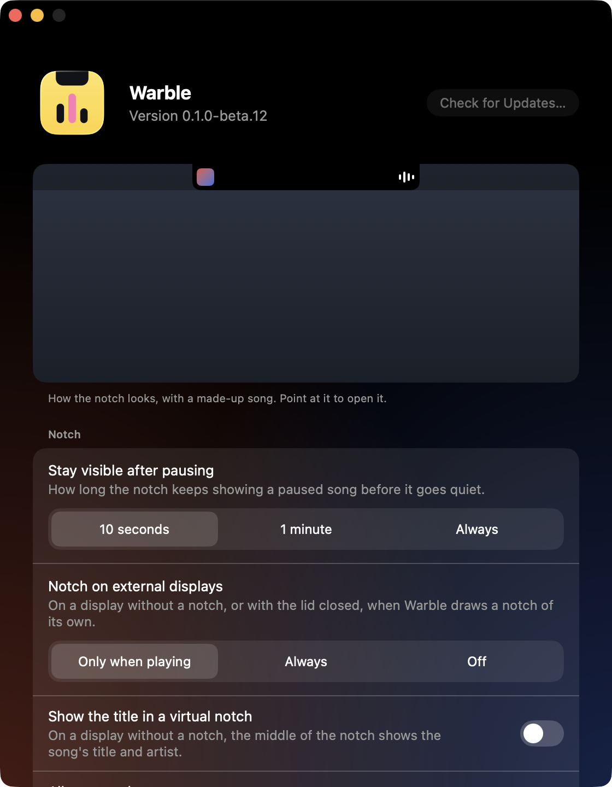
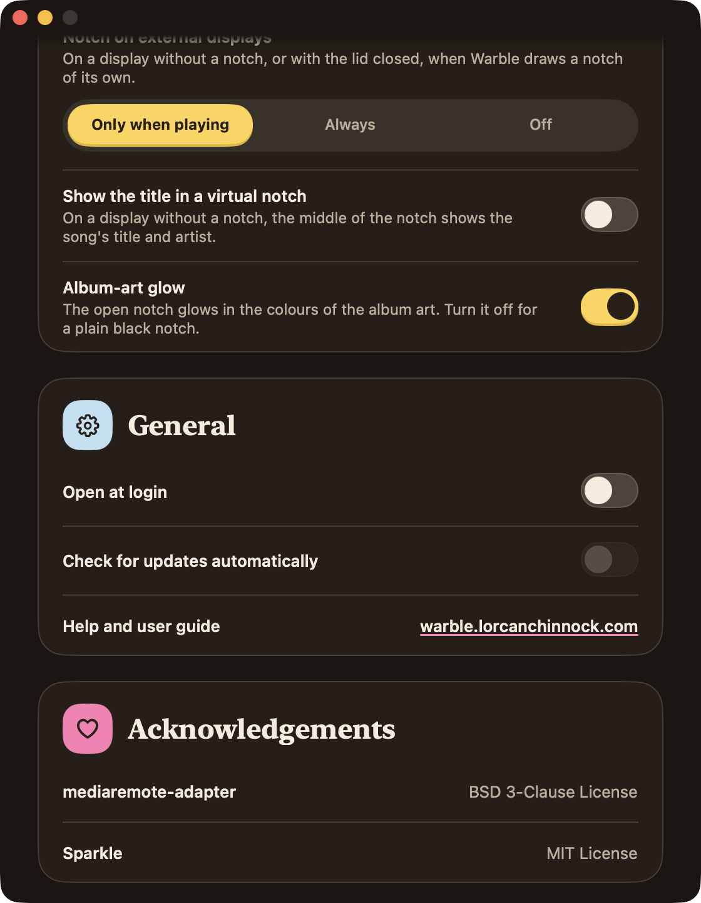

Warble works without changing anything. The things you may want to set are how long a paused song stays in the notch, whether it opens when you log in and, on a display without a notch, whether the notch shows the title.

## Open Settings

1. Click the Warble icon in the menu bar, or right-click the notch. You can also Control-click it.
2. Choose **Settings…**.

The right-click menu also opens the app that's playing, checks for updates and quits Warble. Settings follows your Mac's light or dark appearance, and uses the same cream and yellow as this website.

## What's in Settings

At the top, under the version, is a small preview of the notch with a made-up song. Point at it to open it. It isn't what's playing, so it looks the same when nothing plays. Every setting under it changes it. The title and glow switches show at once, and the notch fades out when you choose Off for external displays. When you change **Stay visible after pausing** or **Notch on external displays**, the song pauses and, a moment later, ends as those settings would: the paused song stays, an empty notch is left, or the notch goes. The preview takes the same short moment for 10 seconds and 1 minute. Move the pointer off the preview and the song plays again.

- **Stay visible after pausing.** 10 seconds at first. When you pause, the song stays in the notch for this long, then Warble hides. Choose **1 minute**, or **Always** to keep it until something else plays or the app stops. If you change it while a song is paused, the new time counts from the pause.
- **Opened notch size.** **Default** at first. How big the notch is when you open it: **Small** or **Large** instead. The closed notch never changes size, so it keeps matching a real notch, and it applies on every display.
- **Notch on external displays.** **Only when playing** at first. On a display without a notch, or with the lid closed, Warble draws a notch of its own. Choose **Always** to keep an empty black notch there after the music stops, or **Off** to draw none. Your MacBook's own notch is never affected. See [External displays](/docs/external-displays/).
- **Song title font.** **Default** at first. The typeface the notch sets the song's title in: **Rounded**, **Serif** or **Mono** instead. The artist and album stay in the default font.
- **Use the album's colour.** Off at first. The song's title and the moving bars take a colour from the album art. If the cover is dark or dull, Warble uses a lighter shade of the same colour, or a plain grey for a black cover, so the text stays easy to read on the black notch. With **Increase contrast** on, it goes lighter still.
- **Open at login.** Off at first. Turn it on, and Warble opens each time you log in, so it's there after a restart. It's the same switch as Warble's entry in System Settings › General › Login Items. If you turn Warble off there, turn it back on there.
- **Show the title in a virtual notch.** Off at first. On a display without a notch, which Warble draws a notch for, the middle of the notch shows the title and artist of what's playing. See [External displays](/docs/external-displays/).
- **Album-art glow.** On at first. The open notch glows softly in the colours of the album art. Turn it off for a plain black notch. Warble then only works out the colours if **Use the album's colour** or **Increase contrast** needs them. With **Increase contrast** on in System Settings › Accessibility › Display, the open notch has a solid border in the art's colour instead of a glow, and keeps it either way. Settings' own background follows the switch too.
- **Check for updates automatically.** Warble goes online to check for updates, to find album covers for songs in your browser, and to find an artist's page when you click the artist. Click **Check for Updates…** to check right away, and the version you have is shown beside it.
- **Help and user guide** opens this guide in your browser.

> [!NOTE]
> Warble's animations follow **Reduce motion** in System Settings › Accessibility › Display.
