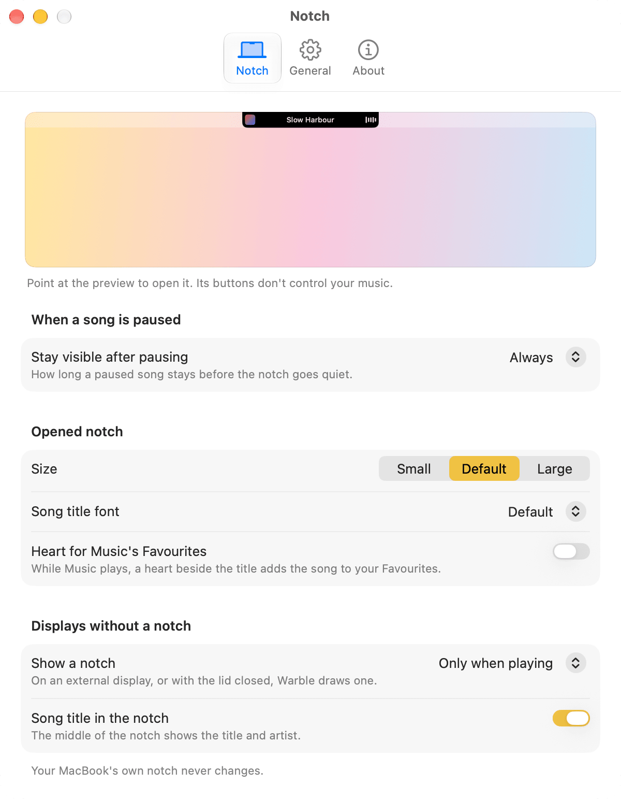
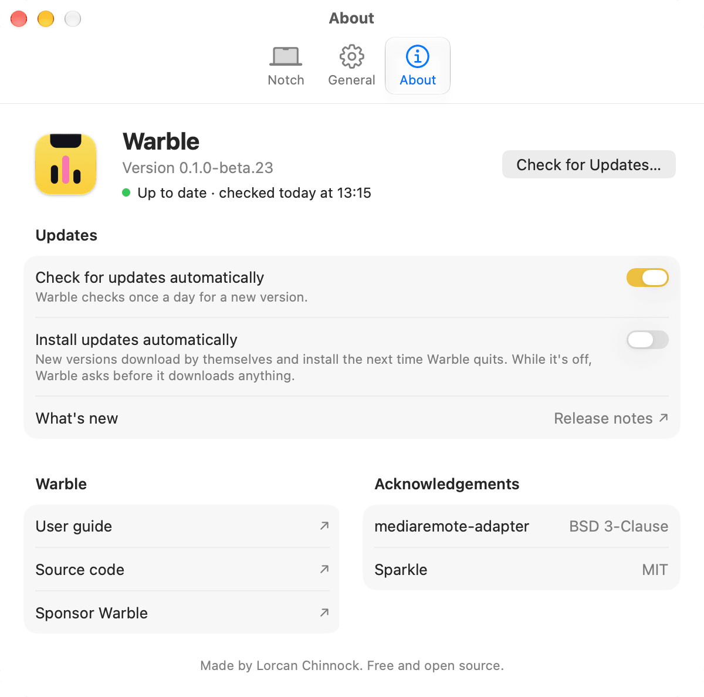

Warble works without changing anything. The settings you're most likely to want are how long a paused song stays in the notch, on the Notch tab, and Open at login, on the General tab.

## Open Settings

1. Click Warble's icon in the menu bar, or right-click the notch. You can also Control-click it.
2. Choose **Settings…**, or press <kbd>⌘,</kbd> while the menu is open.

Settings is a standard Mac window with three tabs along the top: Notch, General and About. It opens on Notch, and it follows your Mac's light or dark appearance. **About Warble**, at the top of both menus, opens it on the About tab.

## Notch

At the top of the Notch tab is a small preview of the notch. It shows the song that's playing, with its art, or a made-up song when nothing plays. Point at it to open it. Its buttons don't control your music.

Every setting under the preview changes it. The title switch shows at once, and the notch fades out when you choose **Off** for **Show a notch**. When you change the song title font, the size or the heart, the preview opens for a couple of seconds to show it, unless Reduce Motion is on. When you change **Stay visible after pausing** or **Show a notch**, the preview's song pauses and, a moment later, ends as those settings would: the paused song stays, an empty notch is left, or the notch goes. The preview takes the same short moment for 10 seconds and 1 minute. Move the pointer off the preview and the song plays again.

### When a song is paused

- **Stay visible after pausing.** **Always** at first. When you pause, the song stays in the notch until something else plays or the app stops. Choose **10 seconds** or **1 minute** to have Warble hide after that long. If you change it while a song is paused, the new time counts from the pause.

### Opened notch

- **Size.** **Default** at first. How big the notch is when you open it: **Small** or **Large** instead. The closed notch never changes size, so it keeps matching a real notch, and the size applies on every display.
- **Song title font.** **Default** at first. The typeface the notch sets the song's title in: **Rounded** or **Mono** instead. The artist and album stay in the default font.
- **Heart for Music's Favourites.** Off at first. While Music is playing, a heart beside the title on the opened notch adds the song to your Favourites in Music, or takes it out. It never shows for other apps. See [Control playback](/docs/control-playback/#add-a-song-to-your-favourites-in-music).

### Displays without a notch

These two settings apply only where Warble draws a notch of its own. Your MacBook's own notch never changes. See [External displays](/docs/external-displays/).

- **Show a notch.** **Only when playing** at first. On a display without a notch, or with the lid closed, Warble draws a notch while something plays. Choose **Always** to keep an empty black notch there after the music stops, or **Off** to draw none.
- **Song title in the notch.** On at first. The middle of a notch Warble draws shows the title and artist of what's playing.

## General

- **Open at login.** Off at first. Turn it on, and Warble opens each time you log in, so it's there after a restart. It's the same switch as Warble's entry in System Settings › General › Login Items & Extensions, and the same one the window from your first launch offers. If you turn Warble off in System Settings, the text under the switch says so, and **Open Login Items…** takes you there to turn it back on.
- **Help** opens this guide, or its [When nothing shows](/docs/when-nothing-shows/) page, in your browser.

## About

About shows Warble's version and, under it, whether Warble is up to date and when it last checked. **Check for Updates…** beside it checks right away. When a new version is ready, the line says so and the button becomes **Update…**.

- **Check for updates automatically.** Warble checks once a day for a new version. Warble asks once, the second time you open it, whether to turn this on.
- **Install updates automatically.** Off at first. New versions download by themselves and install the next time Warble quits. While it's off, Warble asks before it downloads anything. You can turn it on only while Warble checks for updates automatically.
- **What's new** opens the [release notes](/changelog/) for every version.
- The links under them open this guide, Warble's source code and the page for sponsoring Warble. Acknowledgements names the open-source code Warble is built on, with its licence.

[Updates](/docs/updates/) covers the update window, the dot on the menu bar icon and what each line under the version means.

> [!NOTE]
> Warble's animations follow **Reduce motion** in System Settings › Accessibility › Motion.
