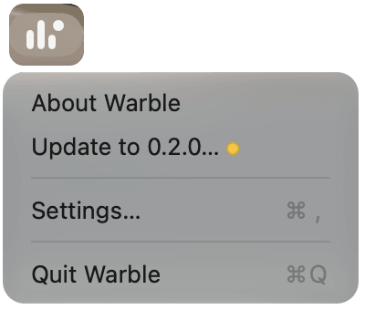

Warble updates itself. If you let it, it checks once a day, and when a new version is ready a small dot appears on its menu bar icon.

## How Warble checks

The second time you open Warble, it asks once whether to check for updates automatically. If you say yes, it checks once a day. You can change your answer at any time with **Check for updates automatically**, on the About tab of [Settings](/docs/settings/#about).

To check right away, click Warble's icon in the menu bar, or right-click the notch, and choose **Check for Updates…**. The Software Update window opens and says **Checking for updates…**, with **Cancel** to stop. If you already have the newest version, a short message says so.

## See whether Warble is up to date

The About tab of Settings shows the version you have, with a line under it:

- **Up to date · checked today at 09:12**, with a green dot, after a check since Warble opened found nothing new.
- **Last checked today at 09:12**, with a grey dot, when the last check was before Warble last opened. Click **Check for Updates…** to check again.
- **Checking for updates…** while a check runs.
- **Version 0.2.0 is ready**, with a yellow dot, when there's a new version. Click **Update…** to see it.
- **Couldn't reach the update server. Check your connection.**, with a grey dot, when a check failed. Click **Try Again** once you're back online.

## When a new version is ready

The menu bar icon keeps its three bars and gains a small dot at its top right. In both menus, **Update to 0.2.0…**, with the new version's number and a yellow dot, takes the place of **Check for Updates…**. Choose it to open the Software Update window.

If you let Warble check automatically, the Software Update window also opens by itself when a check finds a new version. Apart from the window at your first launch and the question about checking, it's the only window Warble opens on its own.

## Install an update

The Software Update window says which version is ready and which one you have, how big the download is, and that Warble quits and reopens to finish. Under that is what's new in every version since yours.

1. Click **Install and Relaunch**. The window shows the download's progress and about how long is left.
2. When the download finishes, click **Relaunch Now**. Warble quits and opens the new version, and your music keeps playing.

You can close the window while it downloads. The download carries on, and the menu item shows how far it's got, such as **Downloading 0.2.0 (53%)…**. Choose it to see the window again. If you click **Later** instead of **Relaunch Now**, the new version installs the next time Warble quits.

The other buttons wait:

- **Remind Me Tomorrow** offers the version again at the next day's check. Closing the window does the same. It's there only while Warble checks automatically, since otherwise there's no next check.
- **Skip This Version** stops offering that version. Warble offers the next one when it comes out.

An important fix may come without either button, so it can't be put off.

## Install updates automatically

Tick **Install updates automatically from now on** in the Software Update window, or turn on **Install updates automatically** on the About tab, and new versions download by themselves and install the next time Warble quits. Usually you won't see the window for them. Turn it off on the About tab, and Warble asks before it downloads anything again.

> [!NOTE]
> If a new version of Warble is installed some other way while it's running, such as with the install command, the Software Update window says it's installed and offers **Relaunch** to start using it.
